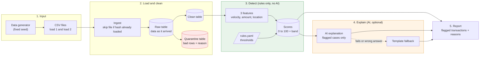

# Fraud Feature Pipeline (DAI-023)

A pipeline that turns synthetic card transactions into fraud features (velocity, unusual amount, location change) and a rule-based risk score, with AI-written explanations for flagged transactions.

## Problem statement

Fraud analysts need to know which card transactions deserve a closer look, and why. This project takes synthetic transactions and computes three suspicious-activity indicators: velocity (many transactions in a short time), unusual amount (far above the customer's normal spend) and location change (two far-apart cities in too little time). It then produces a scored output and states clearly which parts are rules and which part is AI.

**Business goal:** give a fraud analyst a ranked list of flagged transactions, each with a score, the rules that fired and a short explanation.

## Approach

- **Layered pipeline:** raw (data exactly as it arrived), clean, quarantine (bad rows kept with a reason, never silently dropped), features, scores, explanations.
- **Rules produce the score.** Thresholds live in `config/rules.yaml`, so a rule can be changed without touching code. The score is capped at 100 and mapped to LOW, MEDIUM or HIGH.
- **AI only explains.** For MEDIUM and HIGH transactions, an LLM writes a short explanation from the computed facts. It never changes a score. If the LLM is down or its answer contains a number or city that is not in the facts, a template explanation is used instead.
- **Robust z-score for amounts.** The baseline uses median and MAD of the customer's earlier amounts, because one big purchase would distort mean and standard deviation and hide later fraud.
- **Safe reruns.** Files are skipped by hash, clean rows use `INSERT OR IGNORE`, features and scores use `INSERT OR REPLACE`.

| Rules (deterministic) | AI (optional last layer) |
|---|---|
| Features, score, band, triggered rules | Explanation text for flagged transactions only |

## Architecture and data flow



### How the data moves

1. **Input.** I generate synthetic transactions with a script. It uses a fixed seed, so I get the same data every time. The data is saved as two CSV files: load 1 (first 12 days) and load 2 (last 2 days), so I can test loading new data later.
2. **Load and clean.** Each CSV goes into a raw table exactly as it arrived. If the same file comes again, it is skipped. Then I clean the data. Good rows go to the clean table. Bad rows (missing id, bad amount, bad date) go to the quarantine table with the reason, so nothing disappears silently.
3. **Detect.** From the clean table I calculate three features for each transaction: how many transactions in the last hour, how unusual the amount is, and how fast the customer seems to have travelled. Rules and thresholds from rules.yaml turn these features into a score from 0 to 100 and a band (LOW, MEDIUM or HIGH). No AI is used in this stage.
4. **Explain.** Only after the score is ready, the AI writes a short explanation for flagged transactions. If the AI fails or gives a wrong answer, a template explanation is used instead. The score never changes in this stage.
5. **Report.** The final report lists the flagged transactions with their score, the rules that fired and the explanation. The report gets scores directly, so it is still produced if the AI is down.

## Setup

Requirements: Python 3.10 or newer (SQLite 3.28 or newer, which ships with Python 3.10+).

```bash
git clone https://github.com/rituAg2004/fraud-feature-pipeline.git
cd fraud-feature-pipeline
python -m venv .venv
# Windows (PowerShell):  .venv\Scripts\Activate.ps1
# Windows (Git Bash):    source .venv/Scripts/activate
# Mac / Linux:           source .venv/bin/activate
pip install -r requirements.txt
cp .env.example .env
```

## How to run

Generate the sample data (optional, the CSV files are already committed):

```bash
python -m src.generate_data --seed 42 --out data/sample
```

Run the pipeline (ingest, then clean). It is safe to run again; nothing changes on a rerun:

```bash
python -m src.run_all
```

Load files one at a time to see incremental loading:

```bash
python -m src.run_all --files data/sample/transactions_day1.csv
python -m src.run_all --files data/sample/transactions_day2.csv
```

Run the tests:

```bash
pytest -q
```

Expected result today: `3 passed`.