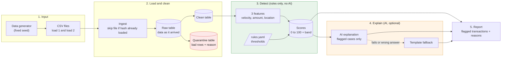

# Fraud Feature Pipeline (DAI-023)

A pipeline that turns synthetic card transactions into fraud features (velocity, unusual amount, location change) and a rule-based risk score, with AI-written explanations for flagged transactions.

## Problem statement

Fraud analysts need to know which card transactions deserve a closer look, and why. This project takes synthetic transactions and computes three suspicious-activity indicators: velocity (many transactions in a short time), unusual amount (far above the customer's normal spend) and location change (two far-apart cities in too little time). It then produces a scored output and states clearly which parts are rules and which part is AI.

**Business goal:** give a fraud analyst a ranked list of flagged transactions, each with a score, the rules that fired and a short explanation.

## Approach

- **Layered pipeline:** raw (data exactly as it arrived), clean, quarantine (bad rows kept with a reason, never silently dropped), features, scores, explanations.
- **Rules produce the score.** Thresholds live in `config/rules.yaml`, so a rule can be changed without touching code. The score is capped at 100 and mapped to LOW, MEDIUM or HIGH.
- **AI only explains.** For MEDIUM and HIGH transactions, an LLM writes a short explanation from the computed facts. It never changes a score. If the LLM is down or its answer contains a number or city that is not in the facts, a template explanation is used instead.
- **Robust z-score for amounts.** The baseline uses median and MAD of the customer's earlier amounts, because one big purchase would distort mean and standard deviation and hide later fraud.
- **Safe reruns.** Files are skipped by hash, clean rows use `INSERT OR IGNORE`, features and scores use `INSERT OR REPLACE`.

| Rules (deterministic) | AI (optional last layer) |
|---|---|
| Features, score, band, triggered rules | Explanation text for flagged transactions only |

## Architecture and data flow



### How the data moves

1. **Input.** I generate synthetic transactions with a script. It uses a fixed seed, so I get the same data every time. The data is saved as two CSV files: load 1 (first 12 days) and load 2 (last 2 days), so I can test loading new data later.
2. **Load and clean.** Each CSV goes into a raw table exactly as it arrived. If the same file comes again, it is skipped. Then I clean the data. Good rows go to the clean table. Bad rows (missing id, bad amount, bad date) go to the quarantine table with the reason, so nothing disappears silently.
3. **Detect.** From the clean table I calculate three features for each transaction: how many transactions in the last hour, how unusual the amount is, and how fast the customer seems to have travelled. Rules and thresholds from rules.yaml turn these features into a score from 0 to 100 and a band (LOW, MEDIUM or HIGH). No AI is used in this stage.
4. **Explain.** Only after the score is ready, the AI writes a short explanation for flagged transactions. If the AI fails or gives a wrong answer, a template explanation is used instead. The score never changes in this stage.
5. **Report.** The final report lists the flagged transactions with their score, the rules that fired and the explanation. The report gets scores directly, so it is still produced if the AI is down.


## Technologies used

- **Python**: pipeline code
- **SQLite**: storage and SQL window functions (velocity, previous transaction)
- **pandas and numpy**: median, MAD, haversine distance
- **PyYAML**: reads the rules from `config/rules.yaml`
- **pytest**: tests
- **requests**: HTTP call to the LLM provider
- **python-dotenv**: reads settings from `.env`
- **Google Gemini** (optional): writes explanations for flagged transactions

## Project structure

```text
fraud-feature-pipeline/
├── README.md
├── requirements.txt
├── .env.example
├── .gitignore
├── .gitattributes
├── config/
│   └── rules.yaml
├── data/
│   ├── reference/city_coords.csv
│   └── sample/            transactions_day1.csv, transactions_day2.csv,
│                          customers.csv, ground_truth.csv
├── docs/
│   ├── problem_analysis.md
│   ├── architecture.md
│   └── sample_output.md
├── sql/
│   ├── 01_schema.sql
│   └── 02_features.sql
├── src/
│   ├── config.py          paths and rules loader
│   ├── generate_data.py   synthetic data with fixed seed
│   ├── ingest.py          raw load with file hash check
│   ├── clean.py           validation, quarantine, deduplication
│   ├── features.py        velocity, amount baseline, location change
│   ├── scoring.py         rules to score and band
│   ├── llm_client.py      LLM interface (gemini, none)
│   ├── explain.py         prompt, validator, template fallback
│   ├── report.py          flagged report and rule coverage
│   └── run_all.py         runs the whole pipeline
├── scripts/
│   ├── masking_demo.py    normal z-score vs robust z-score
│   └── demo_failure.sh    pipeline survives an LLM outage
└── tests/                 12 tests (pytest)
```

## Setup

Requirements: Python 3.10 or newer (SQLite 3.28 or newer, which ships with Python 3.10+).

```bash
git clone https://github.com/rituAg2004/fraud-feature-pipeline.git
cd fraud-feature-pipeline
python -m venv .venv
# Windows (PowerShell):  .venv\Scripts\Activate.ps1
# Windows (Git Bash):    source .venv/Scripts/activate
# Mac / Linux:           source .venv/bin/activate
pip install -r requirements.txt
cp .env.example .env
```

The default `LLM_PROVIDER=none` needs no key: explanations then come from the template. To use Gemini, set `LLM_PROVIDER=gemini`, `GEMINI_API_KEY` and `GEMINI_MODEL` in your local `.env`. Never commit `.env`.

## How to run

Run the whole pipeline (ingest, clean, features, scores, explanations, report). It is safe to run again; nothing changes on a rerun:

```bash
python -m src.run_all
```

The database is created at `data/pipeline.db` (override with the `PIPELINE_DB` environment variable). Reports are written to the `output/` folder.

Load files one at a time to see incremental loading:

```bash
python -m src.run_all --files data/sample/transactions_day1.csv
python -m src.run_all --files data/sample/transactions_day2.csv
```

Regenerate the sample data (optional; the same seed gives identical files):

```bash
python -m src.generate_data --seed 42 --out data/sample
```

Run the tests (expected: `12 passed`):

```bash
pytest -q
```

Demo scripts:

```bash
python scripts/masking_demo.py    # normal z-score vs robust z-score
bash scripts/demo_failure.sh      # pipeline survives an LLM outage
```

## Data model and schema

The full schema is in `sql/01_schema.sql` (11 tables). Raw, clean and quarantine tables hold the data at each cleaning stage; the rest hold computed results or generator-only data.

| Table | What it holds | Why it exists |
|---|---|---|
| `ingested_files` | file name, sha256, row count | A file with the same hash is skipped on rerun; same name with a different hash is reported, not loaded |
| `raw_transactions` | the 7 source columns as TEXT, source file | Data exactly as it arrived, so a bad value never breaks the load and cleaning can be redone |
| `clean_transactions` | typed rows, `ts_epoch`, trimmed title-case city | Primary key on `txn_id` stops duplicates; epoch seconds make time windows easy in SQL |
| `quarantine_transactions` | bad rows plus `reason` | Bad rows are kept, never silently dropped (NULL_TXN_ID, NULL_CUSTOMER, NULL_AMOUNT, NON_POSITIVE_AMOUNT, BAD_TIMESTAMP) |
| `city_coords` | city, latitude, longitude | World fact used to compute distance between two cities |
| `features` | velocity, amount baseline and robust z-score, previous city, distance, speed | Every computed fact; rules and the AI explanation read only this table |
| `scores` | score (0 to 100), band, `triggered_rules`, `rules_version` | `triggered_rules` explains the score; `rules_version` says which thresholds made it |
| `explanations` | text, `source` (llm or fallback), model name | Shows who wrote each explanation |
| `pipeline_runs` | counts per run, status | Operational log; two runs can be compared in the rerun demo |
| `gen_customers` | home city, typical spend | Generator-only profile; the detector never reads it |
| `eval_ground_truth` | `is_fraud`, `fraud_type` | Used only by the report as a sanity check, never by the detector |

## Rules

All thresholds are in `config/rules.yaml`. Points add up and are capped at 100.

| Rule | Fires when | Points | Catches |
|---|---|---|---|
| VELOCITY | 5 or more transactions by the customer in the last 60 minutes | 40 | card testing |
| UNUSUAL_AMOUNT | at least 5 earlier transactions and robust z-score above 3.5 | 30 | large cash-out |
| IMPOSSIBLE_TRAVEL | distance at least 50 km and implied speed above 800 km/h | 40 | cloned card used far away |

Bands: LOW 0 to 29, MEDIUM 30 to 59, HIGH 60 and above. One rule alone gives MEDIUM; two rules together give HIGH.

## AI approach

- **What goes in:** only facts computed by the pipeline (amount, city, score, band, fired rules and the feature values behind them). See `build_prompt` in `src/explain.py`.
- **What comes out:** a two-sentence explanation for a fraud analyst.
- **Where it is stored:** the `explanations` table, with `source` (llm or fallback) and the model name.
- **Which transactions:** only MEDIUM and HIGH, highest score first, up to `explain.max_items` (50). A stored explanation is not regenerated on rerun.
- **Bad answers:** `validate_explanation` rejects empty or too long text, any number that is not in the input facts or the thresholds, and any city that is not the current or previous city. A rejected answer is replaced by `template_explanation`, a deterministic sentence built from the fired rules.
- **Provider down:** if the provider fails, the template is used. After `max_consecutive_failures` failures in a row, the rest of the run uses the template, so a dead provider does not slow the pipeline further.
- **Isolation:** all provider code is in `src/llm_client.py` behind the `LLMClient` interface (`NullClient` and `GeminiClient`). Nothing else imports a provider; the rest of the code only calls `get_client()`. `LLM_PROVIDER` in `.env` selects the provider (`none` or `gemini`).
- **Rules versus AI:** features, score, band and triggered rules are deterministic. The AI only writes explanation text and can never change a score. The failure demo (`scripts/demo_failure.sh`) shows the pipeline finishing with identical scores when the AI is off.


## Assumptions

- All timestamps are UTC and all amounts are in one currency.
- Data is synthetic; fraud labels are injected by our own generator.
- Distance is a straight line between city centres, not road distance.
- `home_city`, `typical_spend` and ground truth exist only in the generator and evaluation; the detector never reads them.
- A customer needs at least 5 earlier transactions before the amount rule can fire.
- The amount baseline is the last 50 earlier transactions of the same customer.
- Flagged transactions are not removed from the baseline (this needs analyst-confirmed labels; future work).

## Tests performed

Run `pytest -q`. Expected: `12 passed`.

| Test | File | Kind | What it proves |
|---|---|---|---|
| `test_duplicate_txn_id_keeps_one` | test_clean.py | Edge case | Duplicates collapse to one row and are counted |
| `test_invalid_rows_quarantined_with_reasons` | test_clean.py | Edge case | Bad rows are kept with a reason, not dropped |
| `test_rerun_is_idempotent` | test_idempotency.py | Rerun safety | A second run changes no table |
| `test_velocity_counts_last_hour` | test_features.py | Logic | Velocity counts correctly and fires at 5 |
| `test_cold_start_no_crash` | test_features.py | Edge case | First transaction gives NULL features and no crash |
| `test_mad_zero_history` | test_features.py | Edge case | Equal past amounts do not cause divide-by-zero |
| `test_impossible_travel` | test_scoring.py | Logic | Travel rule fires only when speed is too high |
| `test_two_rules_together_give_high` | test_scoring.py | Logic | Two rules together reach the HIGH band |
| `test_hallucinated_number_is_rejected` | test_explain.py | Failure | An AI answer with an invented number is replaced by the template |
| `test_correct_ai_answer_is_accepted` | test_explain.py | Logic | A correct AI answer is stored with source `llm` |
| `test_pipeline_survives_llm_outage` | test_explain.py | Failure | AI down: pipeline finishes, scores identical |
| `test_detector_independent_of_generator_tables` | test_independence.py | Design check | Scores do not depend on generator-only tables |

### Failure demonstration

1. Run the pipeline normally (with a provider set) and check `SELECT source, COUNT(*) FROM explanations GROUP BY source;`.
2. Run `bash scripts/demo_failure.sh`. It sets `LLM_PROVIDER=none` and uses a fresh database.
3. The pipeline finishes with warning lines, every explanation has source `fallback`, and the count and sum of scores match the first run.

The AI is an optional last layer: when it fails, the analyst still gets a template explanation and no score changes.

## Sample output

A full run on the sample data (4,649 raw rows, 4,466 clean, 92 quarantined, 82 flagged) is in [`docs/sample_output.md`](docs/sample_output.md). Rule coverage on the injected fraud:

| fraud_type | transactions | flagged | VELOCITY | UNUSUAL_AMOUNT | IMPOSSIBLE_TRAVEL |
|---|---|---|---|---|---|
| card_testing | 42 | 23 | 23 | 0 | 0 |
| impossible_travel | 8 | 8 | 0 | 0 | 8 |
| large_amount | 8 | 8 | 0 | 8 | 0 |
| legit_large (not fraud) | 5 | 5 | 0 | 5 | 0 |
| normal | 4403 | 38 | 0 | 38 | 0 |

The labels come from our own generator, so this is a sanity check, not accuracy.

## Known limitations

- **Synthetic labels.** Rule coverage shows which rule catches which injected pattern, not real-world accuracy.
- **No HIGH on the sample data.** Each injected fraud type triggers one rule, and HIGH needs two. The HIGH band is covered by a unit test.
- **Velocity fires only from the fifth transaction**, so 23 of 42 card-testing transactions are flagged; the first ones in a burst are not.
- **False positives from small MAD.** When a customer's spend is very consistent, a normal rise can exceed the 3.5 threshold. 38 of 4,403 normal transactions (about 1%) were flagged this way, and the 5 legitimate large purchases are flagged too.
- **Straight-line distance** between city centres.
- **Baseline can contain earlier fraud**, because flagged transactions are not removed from it.
- **Full recompute.** Features are recomputed for all rows on every run.
- **Single machine, SQLite.**
- **AI wording can vary**, and a free-tier provider can be slow or unavailable (HTTP 503, timeouts). The pipeline then falls back to templates.


## What I would improve for production

- Streaming ingestion and incremental feature computation instead of a full recompute.
- A feature store, and a warehouse with date partitions (for example Postgres or BigQuery) for larger volumes.
- Real labels, then a Random Forest or XGBoost model blended with the rules, measured by PR-AUC on a time-based split.
- Analyst feedback loop: exclude confirmed fraud from baselines and tune thresholds from outcomes.
- A minimum-MAD floor for the amount baseline, to reduce false positives for very consistent spenders.
- More features: device, IP, merchant.
- Monitoring and alerts, access control, and masking of personal fields.