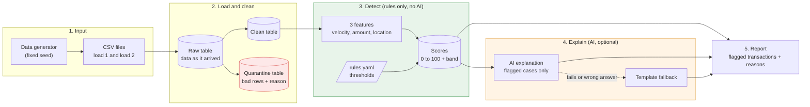

# Architecture

## Data flow

## How the data moves

1. **Input.** I generate synthetic transactions with a script. It uses a fixed seed, so I get the same data every time. The data is saved as two CSV files: load 1 (first 12 days) and load 2 (last 2 days), so I can test loading new data later.
2. **Load and clean.** Each CSV goes into a raw table exactly as it arrived. If the same file comes again, it is skipped. Then I clean the data. Good rows go to the clean table. Bad rows (missing id, bad amount, bad date) go to the quarantine table with the reason, so nothing disappears silently.
3. **Detect.** From the clean table I calculate three features for each transaction: how many transactions in the last hour, how unusual the amount is, and how fast the customer seems to have travelled. Rules and thresholds from rules.yaml turn these features into a score from 0 to 100 and a band (LOW, MEDIUM or HIGH). No AI is used in this stage.
4. **Explain.** Only after the score is ready, the AI writes a short explanation for flagged transactions. If the AI fails or gives a wrong answer, a template explanation is used instead. The score never changes in this stage.
5. **Report.** The final report lists the flagged transactions with their score, the rules that fired and the explanation. The report gets scores directly, so it is still produced if the AI is down.

## Rules versus AI

| Rules (deterministic) | AI (explanation only) |
|---|---|
| Features: velocity, amount anomaly, location change | Two-sentence explanation for MEDIUM and HIGH transactions |
| Score from 0 to 100 | Uses only facts computed by the rules |
| Band: LOW, MEDIUM or HIGH | Validated; replaced by a template if wrong or unavailable |
| Triggered rules list | Never changes a score |